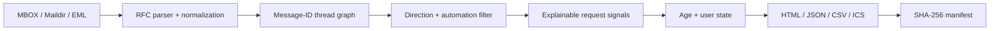

# Algorithm and architecture

LoopLedger separates parsing, conversation reconstruction, classification, state, and rendering so
each stage can be tested with fictional evidence.

## 1. Parsing and normalization

The parser uses Python's standard `email` and `mailbox` modules. It extracts only the fields needed
for the decision:

- Message-ID, References, and In-Reply-To;
- date normalized to UTC;
- normalized sender and recipient addresses;
- decoded subject and current plain-text body, or text extracted from HTML;
- Gmail labels, Auto-Submitted, Precedence, List-Id, and content types.

Attachments are never opened. Script and style content is ignored during HTML-to-text conversion.
Common quoted-history blocks and `>` lines are removed before request scoring.

Messages without a usable date or sender are skipped with a source-specific warning. `--strict`
turns any such warning into exit `3` after diagnostic/report output has been written.

## 2. Thread reconstruction

Every message starts as a graph node. Existing `References` and `In-Reply-To` IDs create union
edges. Messages without usable reference edges may be joined only when both the normalized subject
and exact set of external participants match. Empty subjects or participant sets never use the
fallback.

Thread and loop IDs are SHA-256-derived deterministic identifiers over message IDs. They are
stable evidence handles, not authentication tokens.

## 3. Direction

An address is "self" only if it matches a supplied `--identity` or an address inferred from an
explicit Gmail `Sent` label. LoopLedger does not guess an identity from frequency.

- self sender plus an external recipient: outbound;
- external sender plus self recipient or Inbox label: inbound;
- self sender with only self recipients: self;
- anything else: unknown and excluded.

## 4. Automated-message filter

A message is removed from the meaningful conversational tail when evidence includes an automated
Auto-Submitted value, bulk/list precedence, List-Id, a no-reply/bounce sender, a known automated
subject, or delivery-status content. Counts remain in the report summary.

## 5. Request score

Only the last meaningful outbound message is scored. Signals are additive and deduplicated:

| Signal | Score | Examples |
| --- | ---: | --- |
| `explicit_request` | 3 | "Could you", "please", "let me know", `请`, `麻烦`, `能否` |
| `question_mark` | 2 | `?` or the full-width Chinese question mark |
| `decision_or_review` | 2 | approve, confirm, review, feedback, `批准`, `确认`, `审核` |
| `deadline_language` | 2 | by Friday, EOD, next week, `截止`, `本周`, `尽快` |
| `follow_up_language` | 2 | checking in, pending, `跟进`, `等待` |
| `question_form` | 1 | who/what/when/how, `何时`, `为什么`, `如何` |

The default inclusion threshold is `3`. Empty and courtesy-only text scores zero. The
`--include-all-outbound` mode bypasses the threshold but records the weak-evidence reason.

## 6. Age and state

The current outbound request must be at least `--min-age` old. It becomes overdue at
`--overdue-after`. `--as-of` fixes the clock for reproducible reports and tests.

Version-1 state files can ignore, resolve, or snooze a loop by loop ID or final Message-ID. A future
snooze wins over age; an expired snooze returns to normal open/overdue behavior. Source mail is
never changed.

## 7. Reports and integrity

All mailbox-controlled HTML is escaped. The report has no JavaScript or remote resources. JSON is
the canonical evidence schema; CSV and ICS are projections. `manifest.json` records SHA-256 and
byte count for every output plus content fingerprints of each input source.

## Known limits

- A reply closes the current request even if it only promises future work.
- Indirect, idiomatic, or unsupported-language requests can score too low.
- A damaged export without reference headers can be mis-threaded by the conservative fallback.
- BCC-only outbound mail may need better headers from the exporting client.
- LoopLedger is a snapshot analyzer, not a live notification service.

Use `--include-all-outbound` to audit possible false negatives, keep `--strict` for archival work,
and review evidence before acting.
